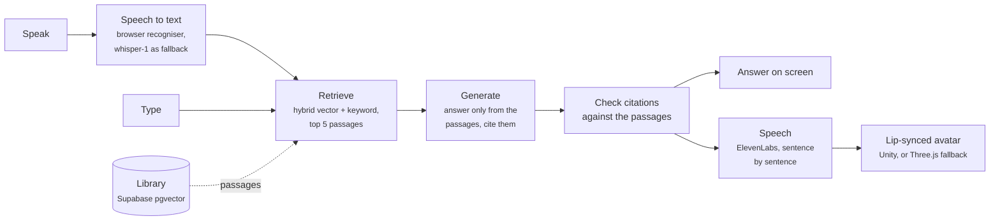

# DementiaGuide AI — Research Compendium

This repository is the **research compendium** for Part IV project #49 (COMPSYS/ELECTENG/SOFTENG
700, 2026), Department of Electrical, Computer, and Software Engineering, University of Auckland.
It holds the source code of the system that was built, the evaluation plans, the scripts that ran
every evaluation, the data and per-run outputs those scripts produced, and the tables behind the
figures. It is the online technical appendix the Part IV handbook asks for, and it is meant to let
a later student or researcher repeat the work.

It supports two individual final reports, written independently:

| Report | Author |
|---|---|
| *DementiaGuide AI: An Avatar-Based Digital Resource Management System for Dementia Care* (18 Oct 2026) | Richman Tan |
| TODO(JooHyun): title and date | JooHyun Kang |

Supervisor: Assoc. Prof. Jing Sun. Neither report is stored here. Unless stated otherwise, the
section, table and appendix numbers below refer to Richman Tan's report.

**What the project built.** DementiaGuide AI is an assistant for family carers of people living
with dementia in Aotearoa New Zealand. A carer asks a question by typing or speaking; the system
retrieves passages from a curated dementia-care library (the WHO iSupport manual plus NZ sources),
and a language model answers **only from those passages**, citing them inline. Safety rules in the
prompt make it send emergencies to 111 first and name NZ helplines. The answer appears on screen
and can be spoken by a 3D avatar whose lip movements follow the speech. It runs on the web (the
evaluated client), iOS and Android.

## Contents

1. [How the compendium is organised](#1-how-the-compendium-is-organised)
2. [Where each result comes from](#2-where-each-result-comes-from)
3. [Running the system](#3-running-the-system)
4. [Reproducing an evaluation](#4-reproducing-an-evaluation)
5. [Test set-up and conditions](#5-test-set-up-and-conditions)
6. [Data: what is included, what is not, and why](#6-data-what-is-included-what-is-not-and-why)
7. [Figures and media](#7-figures-and-media)
8. [Versions](#8-versions)
9. [Licence and third-party terms](#9-licence-and-third-party-terms)
10. [People and contacts](#10-people-and-contacts)

---

## 1. How the compendium is organised

### Top level

An npm-workspaces monorepo: three apps share one knowledge base and one core library.

| Path | What it is |
|---|---|
| `apps/web/` | **Web app** (Vite + React), deployed on Vercel. The client used in every evaluation and in the usability study. |
| `apps/mobile/` | **Mobile app** (Expo / React Native, iOS and Android). `modules/unity-avatar-module/` embeds the Unity avatar natively. |
| `apps/api/` | **Server-side proxy** (Vercel functions). Holds the provider keys, calls OpenAI and ElevenLabs on the clients' behalf, and stores study and usage data. |
| `packages/core/` | **Shared logic**, imported by all three as `@core/…`: RAG configuration, the prompt, retrieval, citation checking, the voice, speech-synthesis and lip-sync engines. |
| `scripts/` | Tooling: `eval/` (every evaluation), `study/` (usability-study export and analysis), `ingest/` and `migrations/` (building the knowledge base), `lipsync/` (articulation results), `brand/`. |
| `docs/` | All documentation, evaluation plans, results and per-run data (next table). |
| `content/` | Source documents for the knowledge base. `sources/MANIFEST.md` records each document's source, retrieval date, checksum and licence. Third-party documents are git-ignored (section 6); the project's own curated text is committed. |
| `assets/` | The `.glb` avatar models used by the Three.js fallback renderer, and the logo. |
| `unity-avatar/` | The **Unity avatar project**, a git submodule ([Richman-Tan/UnityAvatarProject](https://github.com/Richman-Tan/UnityAvatarProject)): the two Character Creator characters, the co-articulation engine and the articulation test harness. |

### Inside `docs/`

| Path | What it holds |
|---|---|
| `docs/eval/evaluation-plan.md` | **The evaluation plan.** Sections 1–16 are the September design (E1–E12); §17 is the 18 September addendum (DementiaBank, functional verification, capacity, cost); §18 the 8 October reopened evaluations. |
| `docs/eval/plan-19a-…md` to `plan-19k-…md` | **The October follow-up plans** (§19A–§19K), one per run, each committed before the run it describes. |
| `docs/eval/results-*.md` | **Results documents**: what was run, the numbers, and which of the plan's expectations held. `results-2026-09-13.md` covers the September programme; the dated `results-2026-10-*` files cover the October runs. |
| `docs/eval/functional-verification.md`, `scalability.md` | E10 (requirements against evidence) and E11 (capacity per dependency). |
| `docs/eval/README.md` | **How to run the evaluation harness**: every script, its outputs, and the order of work. |
| `docs/report/eval/` | **Per-run outputs**, one file per run: generated answers (`generation_*.json`), retrieval runs (`retrieval_*`), judge scores (`judge_*`), pairwise preferences (`pairwise_*`), safety checks (`safety_*`). Sub-folders: `final/` (the tables used in the report, agreement statistics, cost, load tests), `human/` (human rating sheets and labels), `safety/` (October safety runs), `stt/` (speech recognition), `latency/` (October latency runs), `lipsync/` (articulation harness), `e6/` (perceptual lip-sync test). |
| `docs/report/figures/` | Report figures and lip-sync capture frames (section 7). |
| `docs/study/` | **Usability study design**: protocol, analysis plan, instruments (SUS, Likert items, debrief), tasks, ethics documents, pilot checklist and incident log. The study's results are not here (section 6). |
| `docs/rag/` | How the retrieval pipeline is built and sourced, and the research behind it. |
| `docs/testing/` | End-to-end test flows (Playwright for web, Maestro for iOS). |
| `docs/seminar/` | The July conference presentation. |
| `docs/report/midyear-technical-report.md` (+ `.docx`, `.pdf`) | The mid-year technical report, kept for history. |
| `docs/architecture/`, `docs/web/`, `docs/avatar.md`, `docs/android-unity.md`, `docs/voice-latency-streaming.md`, `docs/mobile-app.md`, `docs/design-system.md` | Engineering documentation for the apps and subsystems. Start at `docs/README.md`. |

### Naming conventions

- **Every generated file carries the commit it was produced at**, as a short git sha in its name
  (for example `retrieval_8a92ecd_v2.json`, run at commit `8a92ecd` with prompt `v2`) and in its
  header. Most headers also name the script that wrote the file, the machine and the date; many
  give the exact command to regenerate it.
- **Nothing under `docs/report/eval/` is edited by hand.** A correction is a new run with a new
  file name.
- **Plans come before runs.** Each October plan (`plan-19x-*.md`) states its conditions and its
  expected results, and was committed before any of the calls it describes. The git timestamps are
  the record of what was predicted in advance (the report's Table I.1 lists the dates).
- Prompt and condition names: `p0` (the May 2026 prompt), `v1` (July), `v2` (the production
  prompt, also called `v2-nz-safety`), `v2-nosafety` (`v2` without its safety-rules block),
  `_none` (no retrieval), `_oracle` (the passages labelled relevant supplied directly, in place of retrieval), `_x3` (three samples
  per question at temperature 0.7), `_final` (the September snapshot `8a92ecd`).

---

## 2. Where each result comes from

Each row is one evaluation, with the code the report uses for it. *Plan* is where it was designed;
*Result* is the document that reports it; *Data* is the per-run output behind the numbers;
*Scripts* produced the data. All paths are relative to the repository root; `eval/` means
`docs/eval/` in the Plan and Result columns, `report/eval/` means `docs/report/eval/`, and scripts are
under `scripts/eval/` unless shown otherwise.

### RQ1 — retrieval, grounding and safety

| Code | What | Report | Plan | Result | Data | Scripts |
|---|---|---|---|---|---|---|
| E1 | Retrieval benchmark: is the right passage in the top five? | §5.1, Table A.6 | `evaluation-plan.md` §5, §7 | `results-2026-09-13.md` §1 | `report/eval/retrieval_8a92ecd_*`, `retrieval_e97b0ef_v2_pooled.json`; labels in `report/eval/human/retrieval-labels_R2.json`; agreement in `report/eval/final/agreement_retrieval_R1_vs_R2.md` | `run-retrieval.mjs`, `compare-retrieval.mjs` |
| E1-C | Sentence-level citation check: does each cited passage support its sentence? | §5.1, Table A.7 | `plan-19b-propagation.md` §19B.2 | `report/eval/final/citation-support_s19b.md` | `report/eval/final/citation-*_s19b.*` | `citation-support.mjs`, `lib/citationPairs.js` |
| E2 | Answer-quality matrix: five prompt conditions, with no, production and oracle retrieval | §5.1–5.2, Tables A.1–A.3, Figure A.1 | `evaluation-plan.md` §5 (E2), §6 | `results-2026-09-13.md` §2; tables in `report/eval/final/tables_seeded.md`, `tables_samples.md` | `report/eval/generation_8a92ecd_*`, `judge_gpt-4o-mini_*`, `pairwise_*`; human sheets in `report/eval/human/` | `run-generation.mjs`, `judge.mjs`, `judge-pairwise.mjs`, `human-sheet.mjs`, `agreement.mjs`, `report-tables.mjs` |
| E2-X | Second model judge from another family (`claude-sonnet-5-5`) | §4.3, Tables A.4–A.5 | `evaluation-plan.md` §18 | `results-2026-10-09-reopened.md`; `report/eval/final/judge-crossfamily_claude-sonnet-5-5.md` | `report/eval/final/judge_claude-sonnet-5-5_*_key60.*`, `agreement_*.md` | `judge.mjs`, `agreement.mjs` |
| E2-R3, E2-R4 | Two independent health-care raters of the 60 answer-quality items | §4.3, Table A.4 | `evaluation-plan.md` §18.5, `plan-19f-extension.md` §19F.3 | `report/eval/final/e2-r3_independent-rater.md`, `e2-r4_second-independent-rater.md` | `report/eval/human/human-sheet_round1_R3.*` and R4 equivalents; `report/eval/final/agreement_human_*` | `r3-make-page.mjs`, `r3-validate.mjs`, `r3-summarise.mjs`, `agreement.mjs` |
| E3 | Held-out safety set (56 items not used in development) | §5.2, Tables B.1–B.2 | `evaluation-plan.md` §5 (E3), §8 | `results-2026-09-13.md`; `report/eval/final/safety-report_samples.md`, `safety-report_seeded.md` | `report/eval/generation_8a92ecd_*`, `report/eval/final/safety-report_*.csv`; items in `scripts/eval/questions.heldout.js` | `safety-checks.mjs`, `safety-report.mjs`, `build-phone-allowlist.mjs` |
| E3-X, E3-A | Larger safety set written by another model (`claude-opus-5-5`), and the persona/helpline ablation | §5.2, Tables B.3–B.4 | `plan-19a-safety.md` | `results-2026-10-10-s19.md` §19A; `report/eval/safety/s19a_S1_33e1aa5.md`, `s19a_S2_33e1aa5.md` | `report/eval/safety/generation_33e1aa5_*`, `s19a_*` (writer output, filter log, corpus snapshots); frozen items `scripts/eval/s19a/questions.s19a.frozen.json` | `s19a/` |
| E3-N | Neutral-prompt control: every NZ cue removed from the prompt, same NZ library | §5.2, Table B.5 | `plan-19d-neutral-prompt.md`, `plan-19e-neutral-x3.md` | `results-2026-10-10-s19.md` §19D, `results-2026-10-10-s19e.md` | `report/eval/safety/generation_0214e82_*`, `generation_e5d6dd3_*`, `s19d_*`, `s19e_*` | `s19d/`, `s19e/`, `prompts/neutral19d.js` |
| E3-S | Scope test: the passage-handling clause removed, a scope rule added | §5.2 | `plan-19g-scope.md` | `results-2026-10-12-s19g.md` | listed in the result document | `s19g/`, `prompts/scope19g.js` |
| E3-M | The escalation ablation on `gpt-4.1`, `gpt-4o-mini` and `claude-sonnet-5-5` | §5.2 | `plan-19h-checkback-crossmodel.md` | `results-2026-10-12-s19h.md` | listed in the result document | `s19h/` |
| E3-L | Lead-passage control: the neutral prompt with an NZ emergency passage placed first | §5.2 | `plan-19k-lead-passage.md` | `results-2026-10-15-s19k.md` | listed in the result document; items `scripts/eval/questions.s19k.js` | `s19k/` |

### RQ2 — the voice-and-avatar interface

| Code | What | Report | Plan | Result | Data | Scripts |
|---|---|---|---|---|---|---|
| E4 | Latency by pipeline stage (headless) and typed turns in the browser | §5.3, Figure 5.2 | `evaluation-plan.md` §9 | `results-2026-09-13.md` | `report/eval/final/latency-bench_8ed29d6_mac-wifi-2026-09-13*`, `latency-web_2026-09-19_typed*` | `latency/bench-pipeline.mjs`, `scripts/parse-latency.mjs` |
| E4-S | Spoken-turn latency, headless, fallback recogniser | §5.3, Table E.2 | `evaluation-plan.md` §18.1 | `results-2026-10-09-reopened.md` §2 | `report/eval/latency/spoken-bench_*` (with `_raw.csv` and `_meta.json`), `spoken-bench_days_2026-10-09_to_11.md` | `latency/bench-spoken.mjs`, `latency/compare-days.mjs` |
| E4-B | Spoken-turn latency in Chrome, primary and fallback recognisers | §5.3, Table E.3 | `evaluation-plan.md` §18.4 | `results-2026-10-09-reopened.md` §6 | `report/eval/latency/browser-bench_*` | `latency/bench-browser.mjs`, `latency/browser-bench-server.mjs`, `latency/rtt-probe.mjs` |
| E5 | Articulation harness: 95 automatic checks that the avatar's mouth shapes match the sounds (for example, lips closed on m, b and p) | §5.3, Table E.1 | `evaluation-plan.md` §10 | `report/eval/lipsync/README.md` | `report/eval/lipsync/*.json`, `g2p-ablation_kb100.md` | `scripts/lipsync/`; the Unity harness in `unity-avatar/` (Tools › LipSync › Run All Fixtures) |
| E6 | Perceptual lip-sync test: 15 raters compared the engine with the earlier one and a still face | §5.3, Table E.4 | `evaluation-plan.md` §10; `report/eval/e6/STOPPING-RULE.md` | `report/eval/e6/e6-results_FINAL-2026-10-10_n15.md` | `report/eval/e6/*.json` (aggregates; interim results kept), `e6-dependence-audit_2026-10-11.json` | `e6-make-stimuli.mjs`, `e6-analyse.mjs`, `e6/`, `scripts/report/reanalyse-e6.py` |
| E7 | Usability study: avatar with voice (Arm A) against text (Arm B), within subjects | §4.4, §5.4, Appendix C | `docs/study/protocol.md`, `analysis-plan.md`; extension `plan-19f-extension.md` | not included (section 6) | not included (section 6); instruments in `docs/study/instruments.md`, `tasks.md` | `scripts/study/` |
| E10 | Functional verification: each requirement against the test or measurement that verifies it | §5.6, Appendix D | `evaluation-plan.md` §17.2 | `docs/eval/functional-verification.md` | the test suites (`npm test`), coverage `report/eval/final/coverage_775adeb.md`, end-to-end flows in `docs/testing/` | `coverage-summary.mjs` |
| E11 | Capacity per dependency (proxy, retrieval call, model and speech providers) | §5.6, Table F.1 | `evaluation-plan.md` §17.3 | `docs/eval/scalability.md` | `report/eval/final/load_proxy_5a1a880_*`, `load_rpc_5a1a880_*` | `load/proxy-load.mjs`, `load/rpc-load.mjs` |
| E11-L | Speech-synthesis load test | §5.6, Table F.2 | `plan-19b-propagation.md` §19B.3 | `report/eval/final/load_tts_e72d595_mac-2026-10-09.md` | the same name with `_raw.csv`, `_meta.json` | `load/tts-load.mjs` |
| E12 | Cost per turn and per month | §5.6, Figure 5.6 | `evaluation-plan.md` §17.4 | `report/eval/final/cost_ff2753e.md` | generation files above; prices `scripts/eval/pricing.2026-09.json` | `cost-model.mjs` |

E8 (reliability evidence) was folded into E10.

### RQ3 — speech recognition on dementia speech

| Code | What | Report | Plan | Result | Data | Scripts |
|---|---|---|---|---|---|---|
| E9 | Word-error rate of five recognisers on ADReSS-2020 (78 speakers with dementia, 78 controls), utterances with pauses (a) and trimmed clips (b) | §5.5, Tables G.1–G.2, Figure 5.4 | `evaluation-plan.md` §17.1 | `results-e9-stt-2026-09-18.md` | `report/eval/stt/wer_*.md`, `.csv` (per-speaker aggregates), `error-profile_*.json` | `stt/prepare-adress.py`, `stt/transcribe-local.py`, `stt/transcribe.mjs`, `stt/wer-report.mjs`, `lib/wer.js` |
| E9 (downstream) | Answer quality on questions with simulated recognition errors | Table G.3, Figure G.1 | `evaluation-plan.md` §17.1 | `report/eval/stt/answer-quality_under_asr-error_8a92ecd.md` | `report/eval/retrieval_3a4dde3_*`, `retrieval_5131155_*`, `generation_8a92ecd_v2_perturbed.json` | `stt/perturb-questions.mjs`, `stt/answer-quality-report.mjs` |
| E9-A | Apple's recogniser, on-device | Table G.1 | `evaluation-plan.md` §18.3 | `results-2026-10-09-reopened.md` §1 | `report/eval/stt/wer_e65cdc2_apple-ondevice-en-NZ.*`, `wer_0b81b1c_apple-ondevice-en-US.*` | `stt/transcribe-apple.mjs`, `stt/apple-ondevice/` |
| E9-C | Chrome's recogniser, on-device and offline | §5.5 | `plan-19c-chrome-ondevice.md` | `results-2026-10-10-e9c.md` | `report/eval/stt/wer_bc68ffb_chrome-ondevice-en-NZ.*`, `chrome-ondevice-*.json` (install, offline proofs, diagnostics) | `stt/transcribe-chrome.mjs`, `stt/chrome-ondevice/` |
| E9-P | How recognition errors propagate into retrieval and safety | §5.5, Table G.4 | `plan-19b-propagation.md` §19B.1 | `results-2026-10-10-s19.md` §19B.1; `report/eval/stt/propagation_5cde14f_s19b.md` | `report/eval/stt/propagation*_5cde14f_*`, `error-model_5cde14f_s19b.json`, `report/eval/generation_5cde14f_*`, `retrieval_5cde14f_*` | `stt/build-error-model.mjs`, `stt/perturb-asr.mjs`, `stt/propagation-report.mjs` |
| E9-K | Check-back rule for garbled questions, the escalate-first version, and its replication | §5.5, Figure 5.5, Tables G.6–G.7 | `plan-19h-checkback-crossmodel.md`, `plan-19i-escalate-checkback.md`, `plan-19j-replication.md` | `results-2026-10-12-s19h.md`, `results-2026-10-12-s19i.md`, `results-2026-10-15-s19j.md`; `report/eval/safety/s19j_a7a1abc.md` | `report/eval/stt/error-model-check_s19j.md`; others listed in each result document | `s19h/`, `s19i/`, `s19j/` (including `bootstrap-ci.mjs`, `validate-error-model.mjs`) |

### Other material

| What | Where |
|---|---|
| Threats to validity, per evaluation (report Appendix I) | the "Threats" notes in `docs/eval/evaluation-plan.md` and in each plan |
| Discrepancies between quoted numbers and their source files, found on 30 September | `docs/eval/errata-2026-09-30.md` |
| Literature search record: the eight OpenAlex searches of 12 October 2026, their filters and results, and the script that ran them | `docs/report/lit-review/openalex-search-2026-10-12.json`, `scripts/report/openalex-check.py` |
| Question sets used in development (sets A, B, C, I, J, N, S) | `scripts/eval/questions.js` |
| The rubric shared by the model judges and the human raters | `scripts/eval/judges/rubrics.js` |
| The prompt conditions | `scripts/eval/prompts/promptVersions.js`; the production prompt in `packages/core/rag/prompt.js` |
| Retrieval settings (models, weights, thresholds) | `packages/core/rag/ragConfig.js` |

### JooHyun Kang's report

TODO(JooHyun): map the sections of your report to the rows above, and add rows for any evidence
your report uses that is not listed here.

---

## 3. Running the system

**Prerequisites:** Node 20.19.4 (see `.nvmrc`), an OpenAI API key, and a Supabase project with
pgvector enabled. An ElevenLabs key enables speech with accurate lip sync. Xcode or Android Studio
for mobile.

```bash
git clone --recurse-submodules https://github.com/Richman-Tan/DementiaGuideAI.git
cd DementiaGuideAI
npm install                              # once, at the root; covers every workspace
cp .env.example .env                     # Supabase and OpenAI keys, for mobile and the scripts
cp apps/web/.env.example apps/web/.env   # the web app's equivalents
```

Keys are never committed (`.env` is git-ignored). Create the database schema and load the library
the first time (run order in [scripts/README.md](scripts/README.md)):

```bash
npm run kb:ingest -- --doc curated
```

Then run a client:

```bash
npm run web          # web app (Vite); without keys it runs with canned replies
npm start            # mobile (Expo); npm run ios / npm run android for native builds
```

The Unity avatar needs a native build with the Unity export present (mobile), or the WebGL build
synced in with `npm run sync:unity -w apps/web` (web); otherwise the Three.js avatar is used. Full
set-up: [docs/mobile-app.md](docs/mobile-app.md), [apps/web/README.md](apps/web/README.md),
[apps/api/README.md](apps/api/README.md).

Checks: `npm test` (Jest and Vitest), `npm run lint`, `npm run typecheck`.

### How an answer is produced



Retrieval details: [docs/rag/README.md](docs/rag/README.md).

---

## 4. Reproducing an evaluation

1. **Find the commit.** Each result file names the commit it was produced at. Check it out
   (`git checkout <sha>`) so the prompt, retrieval settings and scripts are the ones that ran.
2. **Rebuild the library.** The September runs used snapshot `8a92ecd` (453 passages); the
   October runs used the same library with one passage added on 22 September. Download the
   source documents from the URLs in `content/sources/MANIFEST.md` (its checksums confirm they
   are the same files) and run the ingestion scripts at the result's commit (`scripts/ingest/`;
   run order in `scripts/README.md`). `docs/report/kb_chunks_reference.csv` lists the 453
   passages of the September snapshot with a content hash for each, so a rebuilt library can be
   checked against it.
3. **Set the keys** the evaluation needs: `OPENAI_API_KEY` for generation, embeddings,
   `gpt-4o-mini` judging and transcription; `ANTHROPIC_API_KEY` for the Claude judge and the
   Claude runs; `ELEVENLABS_API_KEY` for speech-synthesis latency and load; Supabase keys for
   retrieval.
4. **Run the command** in the result file's header, or the one for that evaluation in
   [docs/eval/README.md](docs/eval/README.md). The generation script takes `--dry-run`, which
   prints the plan and a cost estimate first, and `--resume`, which continues an interrupted run.

**What will and will not match.** Deterministic gates, retrieval metrics, agreement statistics
and every table recomputed from committed files will match exactly. Answers generated again will
not be identical: runs at temperature 0.7 are sampled by design, and even temperature-0 runs with
a fixed seed are not guaranteed to be deterministic by the providers. Hosted models change and are
retired, and the browser's recogniser is a server-side model that changes without notice, so
re-runs measure today's models. Latency depends on the network and the providers' load at the
time. The committed per-run files are the record of what was measured.

---

## 5. Test set-up and conditions

| Item | Value |
|---|---|
| Development and benchmark machine | MacBook, Apple M3, 8 GB memory, macOS 27.0.1; Node v20.19.2; home Wi-Fi in Auckland. Each latency file records the machine, network and a baseline round-trip time to each provider. |
| Browser | Chrome 155.0.8059.39 (E4-B, E9-C) |
| Answer generation | `gpt-4o` (OpenAI), `max_tokens` 600; seeded runs at temperature 0, seed 42; sampled runs three per question at temperature 0.7 (the production setting) |
| Other generation models | `gpt-4o-mini`, `gpt-4.1` (OpenAI) and `claude-sonnet-5-5` (Anthropic), in E3-M and E9-K |
| Embeddings | `text-embedding-3-small` (1,536 dimensions) |
| Model judges | `gpt-4o-mini`; `claude-sonnet-5-5` (E2-X) |
| Safety-item writer | `claude-opus-5-5` (E3-X) |
| Speech recognition | `whisper-1` (the deployed fallback), `gpt-4o-transcribe`, `gpt-4o-mini-transcribe` (API, 19 September 2026); Whisper `large-v2` (MLX 8-bit) and `medium` run locally; Apple's on-device recogniser (en-NZ and en-US); Chrome's on-device recogniser (en-NZ) |
| Speech synthesis | ElevenLabs `eleven_turbo_v2_5`, with character-level timing used for lip sync |
| Avatar | Unity 6000.5.0f1; Character Creator characters Ariana and Aaron; articulation harness at 60 frames per second (`Time.captureFramerate = 60`) |
| Prices | `scripts/eval/pricing.2026-09.json`, checked 18 September 2026 |
| Dates | September programme 13–19 September 2026 (articulation runs from July and 19 September); October follow-ups 8–15 October 2026; usability study September and 9–12 October 2026. Each result file gives the dates and times of its runs. |

The usability study used the deployed web app. In September participants took part remotely and
unaided; in October six sessions ran in person on 9–10 October on the clinical collaborator's
laptop, and five carers took part remotely on 11–12 October on their own devices
(`docs/study/protocol.md`).

---

## 6. Data: what is included, what is not, and why

**Included:** the question sets and their expected behaviours; every generated answer, judge
score and safety check; the human rating sheets and the answer key used to unblind them; the
per-speaker recognition results; latency, load and cost records; the perceptual-test aggregates;
and the knowledge-base manifest.

**Not included:**

| What | Why | How to obtain it |
|---|---|---|
| **DementiaBank / ADReSS-2020 audio, reference transcripts and the recognisers' transcripts** | The TalkBank Ground Rules forbid sharing the data with anyone without access. They are kept in the git-ignored `data/dementiabank/`; only per-speaker and per-group aggregates are committed. | Apply for DementiaBank membership through [TalkBank](https://talkbank.org/), then download ADReSS-2020 from the DementiaBank media server and run `scripts/eval/stt/prepare-adress.py` (section 2, E9). |
| **Usability-study data**: session exports, transcripts, free-text answers, per-participant results, the October extension analysis (`docs/eval/results-2026-10-12-s19f.md`) and the per-participant figure and tables in the report (Figure 5.3, Tables H.1–H.2) | The supervisor advised that this assessed, unpublished evaluation did not require ethics approval, so its results may be assessed but not published. The study's data-management plan (`docs/study/ethics/data-management-plan.md`, §6) also limits the project partner to aggregated results. Exports are written to the git-ignored `docs/study/results/`. | Held by the author with the study records; available to examiners through the supervisor. |
| **The expert reviewers' written feedback** (1 October 2026) | Held with the study records on the same basis. | As above. |
| **Knowledge-base source documents** (`content/sources/`) | Several are copyrighted; each is committed only if its licence allows redistribution. | Download from the URLs in `content/sources/MANIFEST.md`; the checksums there confirm the file. |
| **API keys and `.env` files** | Secrets. | Use your own keys (section 4). |
| **The final reports** | Each report is individual and was written independently. | Submitted through Canvas. |

**Superseded files.** Some files predate the September evaluation and are kept for history only:
`docs/report/rag_eval_*`, `docs/report/baseline/` and `docs/report/latency_results.csv`
(measurements made before September, superseded by `docs/eval/results-2026-09-13.md`);
`docs/report/700b_evaluation_plan.md` (the plan written after the mid-year report, superseded by
`docs/eval/evaluation-plan.md`); `docs/report/results-discussion-conclusion-draft.md` (a mid-year
working draft);
`docs/study/data-state.md` (a database snapshot of 21 September, before the October round).
`docs/architecture/backend-plan.md` describes the backend as planned before `apps/api/` was built.

---

## 7. Figures and media

| What | Where |
|---|---|
| The final report's figures, except Figure 5.3 (per-participant study data, section 6) | `docs/report/figures/final/`, generated by `scripts/report/make-report-figures.py` from the committed result files |
| Mid-year report figures | `docs/report/figures/fig1_checks_passed.png`, `fig2_viseme_montage.png`, `fig3_bilabial_curves.png` (`scripts/make-figures.py`) |
| Lip-sync capture frames (Aaron: bilabial, labiodental, open vowel) | `docs/report/figures/_captures/` |
| Perceptual-test stimuli | generated by `scripts/eval/e6-make-stimuli.mjs` from `scripts/eval/e6/sentences.json` |
| Conference presentation (July) | `docs/seminar/` |

No participant media and no DementiaBank audio are included.

---

## 8. Versions

- **Code and results:** the commit sha in each result file. Key snapshots: `8a92ecd` (the
  September answer-quality matrix and held-out safety set; 453 passages), `33e1aa5` (§19A),
  `0214e82` (§19D), `5cde14f` (§19B propagation), `a7a1abc` (§19J).
- **Unity project:** the submodule commit recorded in this repository
  (`git submodule status`); Unity 6000.5.0f1.
- **This compendium:** the commit tagged TODO(tag), for example `compendium-2026-10-20`, at
  submission.

---

## 9. Licence and third-party terms

The project's code is proprietary, all rights reserved ([LICENSE](LICENSE)). Access to this
repository is granted for assessment and supervision; that does not grant permission to use, copy,
modify or redistribute the code.

Third-party material keeps its own terms:

- **WHO iSupport for Dementia manual** (2019): CC BY-NC-SA 3.0 IGO (`content/sources/MANIFEST.md`).
- **DementiaBank / ADReSS-2020:** the TalkBank Ground Rules (CC BY-NC-SA). Cite the corpus and,
  for Pitt-derived data, NIA grants AG03705 and AG05133.
- **OpenAI, Anthropic and ElevenLabs** outputs stored here were produced under each provider's
  API terms.
- **Character Creator characters** in the Unity project: Reallusion's licence terms.

DementiaGuide AI provides general information only. It is not a substitute for professional
medical advice, diagnosis or treatment.

---

## 10. People and contacts

| Name | Role | Contact |
|---|---|---|
| Richman Tan | Student; system, voice and avatar pipeline, evaluation programme | TODO(Richman): university email |
| JooHyun Kang | Student; knowledge base, retrieval, second rater | TODO(JooHyun): university email |
| Assoc. Prof. Jing Sun | Supervisor | jing.sun@auckland.ac.nz |

Each report's Statement of Contribution gives the full division of work.
